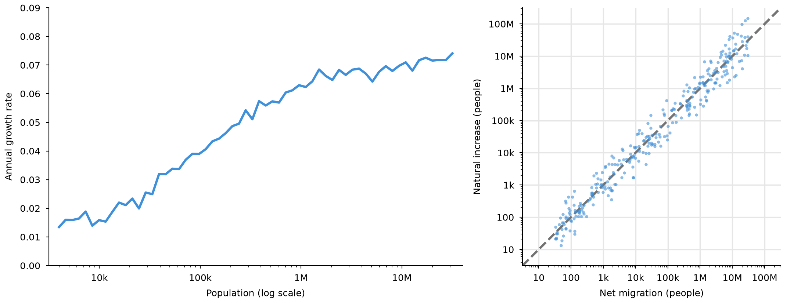

# Log axis

A log axis spaces values by ratio instead of difference. Use it when values span several orders of magnitude, such as city populations or counts. The left panel has a log x-axis with decades labeled 10k, 1M and so on, and "(log scale)" in the axis title. The right panel is log-log with equal aspect, so the 1:1 line runs at 45°.

- `LogLocator(base=10, numticks=12)` puts a major tick at every decade. `numticks` must exceed the number of decades shown, or matplotlib skips some.
- On log axes, give `axline` two points, such as `(1, 1), (10, 10)` for y = x. Its `slope` argument works on linear scales only.
- A log axis shows positive values only.
