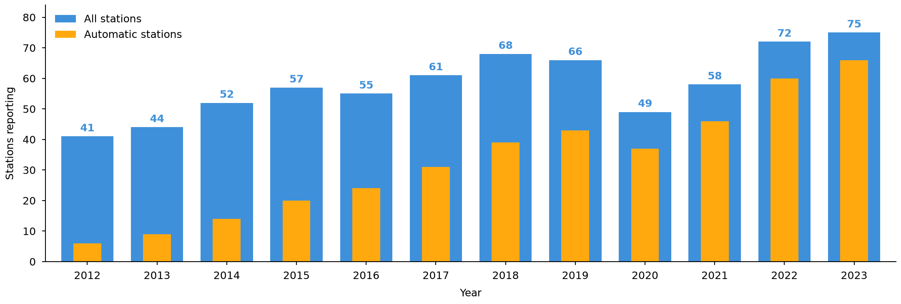

# Bar-in-bar chart

Nested bars show a count and a subset of it across the same categories: a wide bar for the whole and a narrow bar for the subset, centered inside it. The visible top of each wide bar is the part of the whole outside the subset. A subset value must not exceed its total.

- `ALL` and `AUTOMATIC` hold one count per entry in `YEARS`.
- `WIDE` and `NARROW` set the bar widths in x units. `zorder` 1 and 2 keep the narrow bar in front whatever the call order.
- Autoscaling stops at the tallest bar and ignores `bar_label` text, so `set_ylim` leaves 12% headroom above it.
