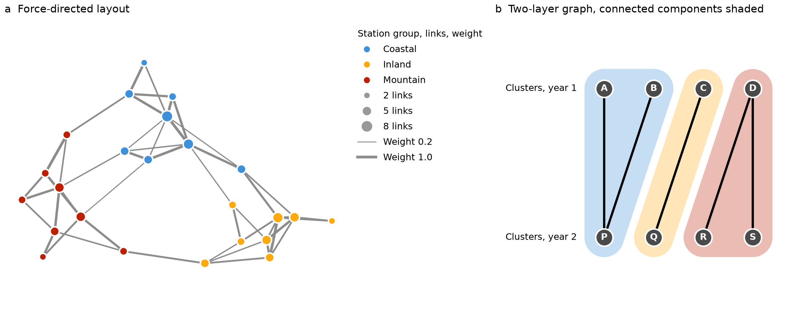

# Network graph

A network graph draws things as nodes and the links between them as edges. Use it when the links matter more than where the things are. A force-directed layout (a) pulls linked nodes together, so densely linked groups form clusters, but its positions carry no meaning. When positions do carry meaning, such as clusters of two dates in two rows (b), fix them and shade each connected component.

- `force_layout` is Fruchterman-Reingold in NumPy. It compares all pairs of nodes, so it suits a few hundred nodes at most, and its result has no fixed orientation. Pass your own symmetric weight matrix (0 = no link) in place of `random_graph`.
- `node_area` and `edge_width` serve both the plot and the legend, so the key matches the marks.
- `set_aspect("equal", adjustable="datalim")` keeps distances equal in x and y without shrinking the axes box.
