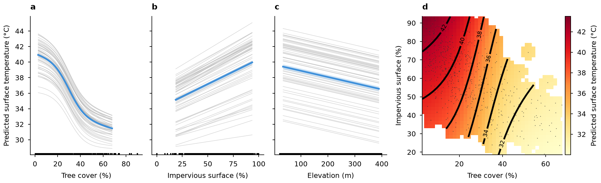

# Partial dependence plot

A partial dependence plot shows how a fitted model's prediction changes along one predictor, averaged over the observed values of the others. In a–c, each gray line is one row of data swept across the grid (an ICE curve), the thick line is their mean, and a rug marks the observed values. ICE curves that fan out show that the mean hides different responses. Panel d sweeps two predictors at once and draws the mean prediction only where there are data.

- Replace `model` with `fitted.predict`. `ice` only needs a function from a table of predictors to predictions.
- The band is a bootstrap 95 % interval over rows (`BOOTSTRAPS` resamples). It shows sampling of the data under one model, not uncertainty in the model; for that, refit the model on each resample.
- Correlated predictors leave parts of the two-predictor grid without data, where the model only extrapolates. `supported` masks cells with no observation within `SUPPORT` of each range.
