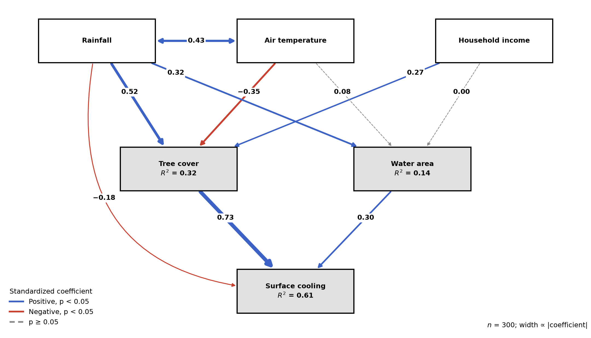

# Path diagram

A path diagram reports a path model or structural equation model: which variables act on which, and how strongly. Each variable is a box, and each arrow is a path labeled with its standardized coefficient. Color gives the sign, line width the size, and a dashed gray line marks a path that is not significant. Shaded boxes are endogenous variables and print their $R^2$; a double-headed arrow is a correlation between two exogenous variables, not a causal path.

- `MODEL` lists, for each endogenous variable, the variables with a path into it, and `fit_paths` fits them by least squares. To draw a model fitted elsewhere (lavaan, piecewiseSEM), fill `paths` and `r2` with its estimates instead.
- `FancyArrowPatch` with `patchA` and `patchB` ends each arrow at the box edges at any angle. Put a path that would cross a box in `CURVED` with an `arc3` radius; its sign sets the side the arc bends to.
- `T_CRIT` sets the significance threshold. State the test in the caption.
