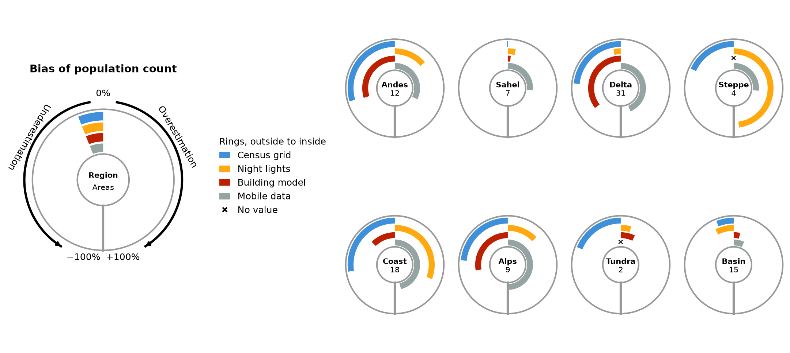

# Radial bar chart

Radial bar glyphs compare several datasets across many regions in a small space. Each region is one glyph and each dataset one concentric ring, in the same order in every glyph. Arc length is the signed value: from 12 o'clock, positive values run clockwise and negative values counter-clockwise, and ±`LIMIT` meet at 6 o'clock. One enlarged key glyph and a legend explain the encoding once for the whole figure.

- `DATASETS` maps each ring to its color, outer ring first. `MISSING` lists (region, dataset) pairs without a value; they get a cross, so they do not read as zero.
- `LIMIT` is the |value| that reaches 6 o'clock. Larger values are clipped at a half turn; say so in the caption or raise `LIMIT`. The scale is linear; for a skewed range, use a different scale on each side and label both ends.
- `Wedge` angles are in degrees anticlockwise from 3 o'clock, so the top is 90°. Every glyph uses limits ±1.1 and the same axes size, so the rings have the same radius in all glyphs.
