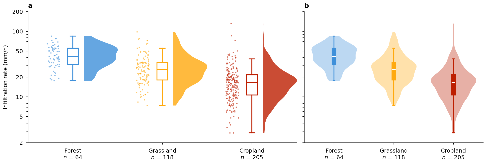

# Raincloud plot

A raincloud plot shows, for each category, the raw points, a box plot of the quartiles and a half-violin of the distribution's shape. Use it when readers should see all three together. A full violin with an inner box (b) takes less width and suits more categories, but it hides the individual points. Every violin is scaled to the same width, so print each category's count under its name.

- Keep `OFFSET - JITTER` above half of `BOX_WIDTH`, so the points stay clear of the box.
- On a log axis, estimate the density on log10 values, as `violin_outline` does, so the violin shape matches the axis.
- `boxplot` applies the 1.5 × IQR whisker rule in linear units, even on a log axis. Pass percentiles such as `whis=(5, 95)`, which do not depend on the scale, or state the rule in the caption.
