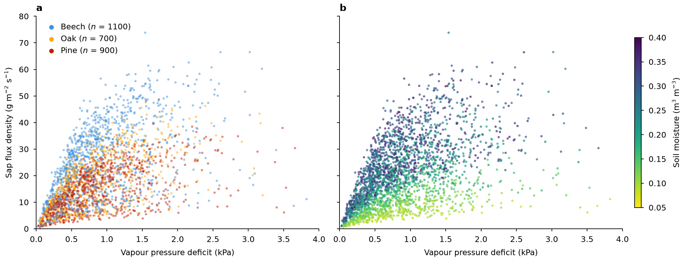

# Scatter plot

A scatter plot places each observation by two values. When thousands of points are colored by group, draw them all in one `scatter` call in random order; drawn group by group, the last group covers the others where they overlap. Small, edgeless, semi-transparent markers (`SIZE`, `ALPHA`) show where points pile up. Panel b colors the same points by a third variable.

- `synthetic` shuffles all arrays with one permutation. Do the same with real data; sorting by the color variable instead puts the highest values on top.
- In panel a, `to_rgba` builds one color per point, and empty `scatter([], [])` calls give the legend handles. In panel b, `bar.solids.set_alpha(1)` draws the color bar opaque although the points are translucent.
- `rasterized=True` stores the points as an image in a PDF at the `savefig(dpi=...)` resolution, while axes and text stay vector. `scatter` raises an error for points outside `LIMITS`, because fixed limits would drop them without a warning.
