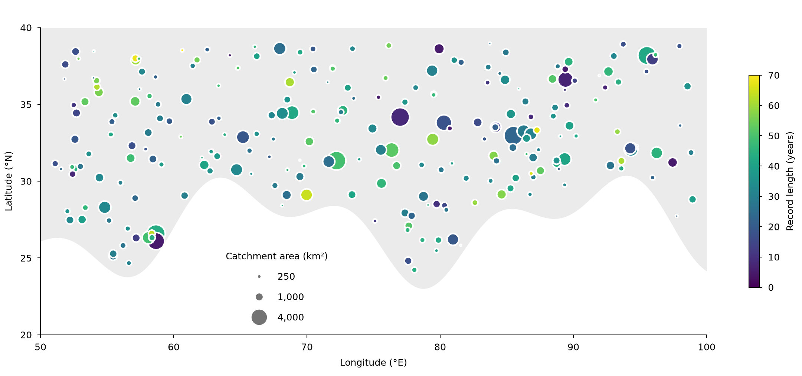

# Size legend

A size legend shows a few round values drawn at the same scale as the markers, so readers can compare any marker with them. Use marker area for a quantity whose totals matter, such as catchment area or population, and color for a second variable at the same points.

- `SIZE_PER_UNIT` converts the value to marker area in points². Scatter's `s` is an area, so a value four times larger gets twice the diameter.
- `legend_elements(prop="sizes", num=LEGEND_SIZES, func=...)` maps marker areas back to data units with `func`, the inverse of `SIZE_PER_UNIT`. It silently drops any value in `num` outside the data range, so keep `LEGEND_SIZES` inside it.
- `draw_gauges` draws the largest markers first, so small ones stay on top.
