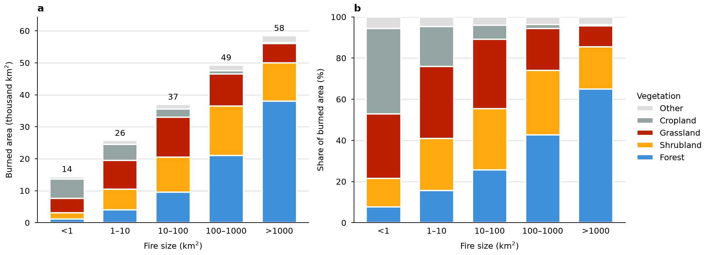

# Stacked bar chart

Stacked bars split each category's total into the same parts. Absolute stacking shows the totals and the size of each part, but only the bottom part shares a baseline. 100% stacking divides each bar by its total, so composition can be compared across bars but the totals are lost. Show both versions, or print the totals elsewhere.

- `PARTS` is ordered bottom to top. Put the part readers compare most at the bottom, where it has a common baseline.
- `get_legend_handles_labels` returns handles in drawing order, bottom first. Reverse them so the legend reads top to bottom like the stack.
- `bar_label` on `containers[-1]` (the top part) prints the totals because `labels` replaces its default, the top part's own value.
