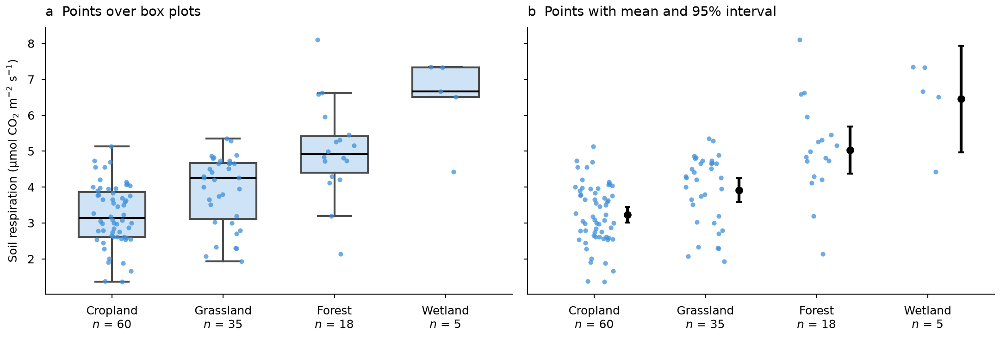

# Strip plot

A strip plot draws every observation as a point, shifted sideways at random within its category so equal values do not overlap. Use it when every value should stay visible, especially when groups differ in size. Over a box plot (a), the points show how many values each box rests on; a box from five values looks as solid as one from sixty. For small groups, draw the mean with its 95 % interval beside the points instead (b).

- `JITTER` is the half-width of the sideways spread in category units. Keep it below half of `BOX_WIDTH`, so the points stay inside the box.
- Pass `showfliers=False` to `boxplot`, or the points beyond the whiskers are drawn twice. Give the jitter in both panels the same seed, so the points sit at the same places.
- `t975` approximates the t quantile without SciPy, within 0.1 % for four or more degrees of freedom. Use `scipy.stats.t.ppf(0.975, df)` when SciPy is available.
