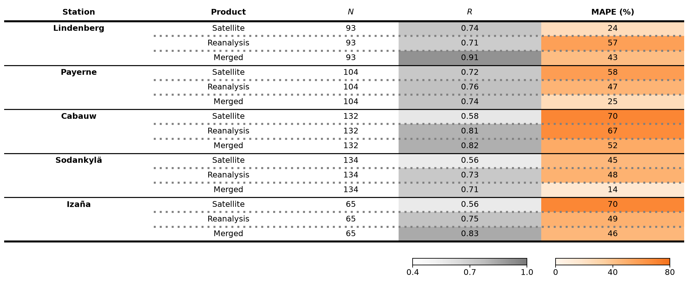

# Table as a graphic

Draw a table as a graphic when it is a panel of a figure and some columns should be read by color as well as by number. Here rows are grouped by station, and the correlation (R) and error (MAPE) cells are shaded by value. A small color bar under each shaded column gives its scale.

- `COLUMNS` gives each column's header, left edge and width on a table 100 units wide. `shading_keys` uses the same units (`transform=ax.transData`) to put each color bar under its column.
- `SHADING` sets a color map, a fixed value range and a number format for each shaded column; fix the range so two tables of the same quantity share a scale. `SHADE_TOP` keeps only the light part of each map, so black text stays readable.
- `ROW_HEIGHT` is in data units. Change the figure height with the number of rows to keep the text spacing.
