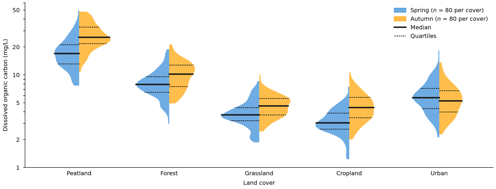

# Split violin plot

A split violin shows two conditions as the left and right halves of one violin per category, so the two distributions sit side by side. Use it when every category is measured under the same two conditions. The median is a solid line and the quartiles are dashed lines across each half. Every half uses one width scale, so widths compare across the whole plot.

- `CONDITIONS` sets each condition's name, color and side: −1 draws the left half, +1 the right. One violin holds only two conditions.
- `HALF_WIDTH` is the width of the widest half in the plot. To give every half the same maximum width instead, divide each density by its own maximum, and say so in the caption.
- `half_outlines` estimates the density on log10 values to match the log y-axis. On a linear axis, pass the values directly.
